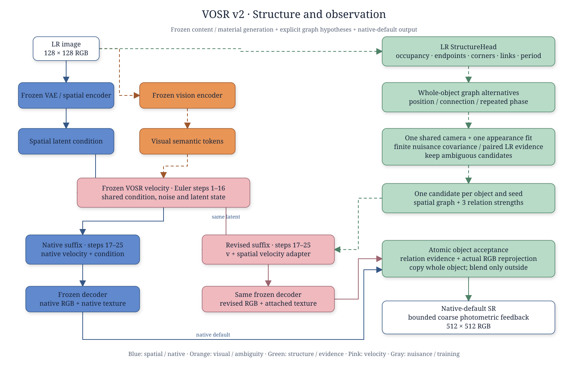

# VOSR v2：结构假设、观测证据与整结构生成

这是一次模型架构重构，身份 `structure-observation-v2.0`，实验协议
[`SOV2-20261111-01`](../../configs/structure_observation_v2.json)。**当前交付为源码实现，尚无服务器 GPU 训练或超分收益结论。**
v1.5 发布源码、权重身份及 `current_recipe.json` 保留作为对照；本版本不依赖 v1.5 的 RGB 配准、分频融合和纹理纠错头。

## 架构与关键层



完整的 [draw.io 文件](../../docs/architecture_v2/structure-observation-v2.drawio) 包含五个可编辑矢量页面：总体、结构表示、观测证据、速度与输出、训练实验。
各页的 [SVG 预览](../../docs/architecture_v2/) 来自同一个 `tools/draw_structure_v2.py`。
配色沿用参考图的空间蓝、语义橙、生成粉，并增加结构绿和成像灰。

| 文件 | 功能与约束 |
| --- | --- |
| `structure.py` | LR 卷积头输出 9 个 HR 图：前景笔画、端点、转角、边界、横纵亲和、重复强度及二维周期。骨架像素为顶点，显式边为连接；端点/转角从图的度和方向重算，辅助预测头参与监督，不允许互相矛盾的点/边直接进入生成。 |
| `observation.py` | 对整个候选集只拟合一次 RGB 前景/背景平面；所有候选通过同一冻结相机及同一组模糊、配准扰动。坏代理拟合直接拒绝提供结构证据。 |
| `model.py` | 12 通道空间条件进入零输出初始化的速度残差。25 步 Euler 前 16 步共享，后 9 步原生/修订分别运行。相同初态、条件、种子，原生分支保持历史 CFG 公式。 |
| `model.py:compose` | 用实际修订 RGB、完整结构与外围接缝共同重投影；同时要求具体结构关系和图像解释改善，才整块复制修订 RGB。内部用 `where` 精确取值，纹理随结构一起换，拒绝区域保留原生。 |
| `model.py:coarse_feedback` | 最后只优化 4×4 RGB 格点并双线性放大；幅度 ≤2/255，每个相机扰动下误差都下降才接受。不做重采样、分频或高频相加。 |
| `train.py` | 先训练结构头，再冻结它与 VOSR，训练速度残差；提供显式损失、梯度检查和失败出口。 |
| `runtime.py` | 加载既有 `probe.FrozenVOSR` 与相机，核对发布相机 SHA；不把随机初始化当成可用模型。 |
| `evaluate.py` | 同种子阶段评价、v1.5 对照、缺失读出计数、按父场景聚类的区间和设备分组。 |

**锁定的新增思路：差异专属的有限成像不确定性。** 对 A/B 候选的 LR 差异 Δ，先去除 RGB 常数和缓慢平面，再由共同成像扰动构造有限协方差，以 `(I+JJᵀ)^(-1/2)` 白化差异与残差。
分别计算白化分离度和残差沿 Δ 的偏好，取共同扰动下的保守值。不能采用无限自由的位移投影，否则真正的位置错误也会被全部消去。
这里是有限候选、局部线性近似下的工程判据，**不是经过校准的后验概率或统计显著性检验**；默认阈值是待开发集检验的协议参数。

候选最多 8 个：LR 图、四个 ±1 HR 像素位置版本、接通、断开，以及可用时的半周期版本。
每个候选都是完整结构，选择一次后贯穿后 9 步；歧义候选保留在诊断记录中，按种子做一次均匀选择。
候选只改一种关系，不声称枚举任意拓扑。选中非参考候选后，不把“移动 vs 接通”这种混合差异当成独立位置/连接证据；未被单因素检验的关系强度为零。
密集纹理、超预算图、互相覆盖的候选对象会被拒绝，交给原生生成。

## 环境与数据

使用现有 CUDA VOSR 环境，安装本目录 `requirements.txt`。本仓库仍不包含冻结 VOSR、DINOv2、解码器、相机权重或 `probe.py`。
`--runtime-root` 指向原发布根目录（原为 `/home/zhangxu/hx/HX001`）；旧模块内部仍可能使用该绝对路径，新入口不会自动改写它们。
新模块通过 `PYTHONPATH=src` 加载，无需覆盖服务器上旧源码。

数据清单是 JSON 数组，图像路径相对清单文件。按 **dataset + 物理 parent** 隔离 train/dev/test，跨相机、裁块、种子也不能跨集。
`mask` 是明确的 HR 笔画/边框前景标注，**不是任意 Canny 边缘当成拓扑真值**。
自然图训练需要这样的标注；无标注时可先跑代码自带的精确合成笔画训练，但不能称为自然图模型已经就绪。
`period` 与 `relations` 可省略；没有它们时不得给出相位或连接恢复结论。方向、端点坐标都以 HR 像素为单位。

```json
[
  {
    "id": "canon_scene_001_crop_0", "parent": "scene_001",
    "dataset": "fresh_paired", "camera": "Canon", "split": "train",
    "lr": "images/lr.png", "hr": "images/hr.png", "mask": "labels/strokes.png",
    "period": [16, 0],
    "relations": [{"a": [40, 80], "b": [140, 80], "connected": true}]
  }
]
```

训练只读取 train 图像；推理只接收 LR。HR 候选选择只发生在速度训练中，选择与标注相容的完整图，不能泄漏到推理。
结构候选监督目前是窄前景笔画/边框假设；曲面、阴影边界及丰富彩色纹理可能让共享外观代理失败，此时应报告拒绝比例，不能偷偷放宽门槛。

## 训练与单图推理

在仓库根目录执行，输出留在服务器而非提交仓库：

```bash
export PYTHONPATH="$PWD/src"
python -m structure_observation_v2.train --stage structure \
  --steps 20000 --batch-size 4 --output outputs/v2/structure_synth.pt

python -m structure_observation_v2.train --stage structure \
  --checkpoint outputs/v2/structure_synth.pt --manifest /data/v2/manifest.json \
  --steps 5000 --output outputs/v2/structure_real.pt

python -m structure_observation_v2.train --stage velocity \
  --checkpoint outputs/v2/structure_real.pt --manifest /data/v2/manifest.json \
  --runtime-root /home/zhangxu/hx/HX001 --steps 10000 \
  --output outputs/v2/model.pt

python -m structure_observation_v2.infer \
  --runtime-root /home/zhangxu/hx/HX001 --checkpoint outputs/v2/model.pt \
  --input /data/lr.png --output outputs/v2/sr.png \
  --diagnostics outputs/v2/one_case --seed 6
```

速度训练随机取原生后段的一步，解码 `z_t − t(v_native + δv)`，监督结构区域 RGB、带符号梯度及外部恒等性。
这是 **clean-prediction 解码代理损失，不是 flow matching**，不假定仓库缺失的 HR 编码接口。
完整后段训练/推理存在状态分布差异，须通过下述全链实验验证；如果冻结解码器封装禁用了 autograd，代码会明确报错，需在服务器暴露可求导的 prefix/suffix。
若 10 倍尝试内不足规定有效结构批次，训练失败，不保存“已训练”模型。检查点记录训练清单散列与训练来源。

## 固定实验方案

一次架构、一个开发集锁定，以下是因果消融，不新开架构分支：

1. **先资格检验。** 在独立合成父模板上检验接通/断开、亚像素位置和周期相位，包含降采样碰撞对。自然开发图检查候选覆盖率；至少 70% 标注结构有相容候选才进入生成评价。HR 参考读出必须有效，生成端点缺失 ≤20%、阈值分歧 ≤10%；不通过就报告表示/读出失败，保留分母，不能把缺失当断开。
2. **联合对照。** 同 LR、同种子比较原生 raw、已发布 locked v1.5、v2；导出 native/revised/composite/final。消融 uniform、wrong_graph、no_acceptance、no_feedback，用于定位观测、空间条件、整结构选择和亮度反馈的作用。
3. **时间定位。** 共享步数 8/12/16/20，即修订后段 17/13/9/5 步。固定权重时这是控制时段干预；若比较最优架构，需要同预算重训，不能把固定 16 步训练权重的外推当公平赢家选择。
4. **确认。** 建议每设备至少 30 个未暴露物理父、种子 6/43/61。设备留一和 RealSR↔DRealSR 留一；已有 A9/E 场景作历史回归，不冒称新确认。先在父内平均种子，再做 2000 次父级配对 bootstrap。

```bash
python -m structure_observation_v2.evaluate \
  --manifest /data/v2/manifest.json --checkpoint outputs/v2/model.pt \
  --runtime-root /home/zhangxu/hx/HX001 --split dev \
  --include-v15 --perceptual --output outputs/v2/dev_01

# 冻结清单、权重、阈值和资格后执行；新目录避免覆盖既有结果。
python -m structure_observation_v2.evaluate \
  --manifest /data/v2/manifest.json --checkpoint outputs/v2/model.pt \
  --runtime-root /home/zhangxu/hx/HX001 --split test \
  --include-v15 --perceptual --output outputs/v2/confirm_01

# 时间干预示例，其余设置不变。
python -m structure_observation_v2.evaluate \
  --manifest /data/v2/manifest.json --checkpoint outputs/v2/model.pt \
  --runtime-root /home/zhangxu/hx/HX001 --split dev --shared-steps 12 \
  --controls full --output outputs/v2/dev_shared12
```

评价会同时记录边界/骨架容差 F1、参考颜色读出的连接错误上下界、缺失/不稳定率、指定周期的相位误差、PSNR，以及可选 LPIPS/DISTS。
连接端点使用半径 2 像素圆盘和固定 .45/.5/.55 三阈值；低对比或缺失不计正确，缺失/不稳定进入错误率上界。复杂多色物体的读出仍可能失效，须保留该结论。
相位读出幅度过低不强行输出角度。正式判断采用各设备结果及最差组；仅 LPIPS 下降、仅通过 LR 重投影、或全部对象拒绝，都不算结构恢复成功。
同时报告接受覆盖率、歧义集大小、实际耗时/显存；脚本保留逐对象决定和逐阶段浮点输出，足以追查失败。
成功/非劣界写在协议 JSON 中，开发阶段可修订协议身份，不能看确认结果后改界。

## 已验证与尚未验证

```bash
PYTHONPATH=src python -m unittest discover -s tests -v
python tools/verify_source.py
python tools/verify_v2.py
```

已做 CPU 的共享初态/原生复现、零初始化恒等、速度反传、同种子选择、成像歧义、光度剔除、整块精确复制、拒绝回退、反馈单调性、父场景泄漏和缺失读出测试；另完成 3 步合成结构训练的优化器/检查点冒烟验证。
CPU API 替身只验证接口与算法不变量；没有冻结资产的实际 CUDA 连通性、整图显存峰值、收敛或超分指标证据。
`provenance_v2.json` 标识新增源码，原 `provenance.json` 的发布文件逐字节保留。
